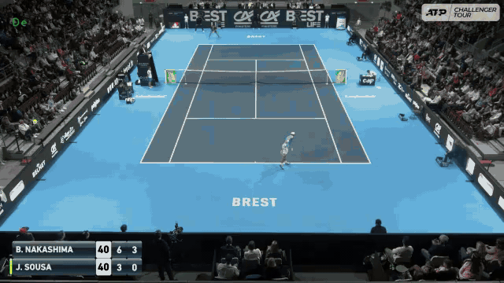
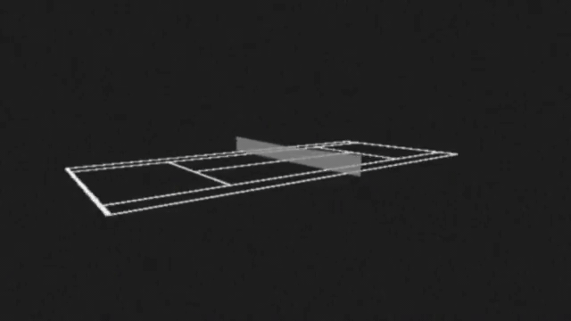

# ATMAN v1

**Automated Tennis Match Annotator · from broadcast video to tennis analysis**

ATMAN turns broadcast tennis footage into structured shot data: who hit the ball, how it travelled, where it bounced, and estimates of speed and spin. That data can then be queried, compared, and visualized.

I built this Python research prototype between 2023 and 2025: the recognition pipeline, a custom data model for points and shots, the analysis utilities, and a small 3D rendering engine. This repository contains the original broadcast-video implementation and the scripts behind the demonstrations on [atman-tennis.com](https://atman-tennis.com).

[How ATMAN works · 3 minutes](https://www.youtube.com/watch?v=S3NeFiitAno) · [Full walkthrough](https://www.youtube.com/watch?v=jwAbKgMGGqU) · [Serve-placement case study](https://www.youtube.com/watch?v=egPHXIpwcnI)

## Recognize the play

Calibrate the court, locate players and the ball, combine visual and audio classifiers, and reconstruct shot trajectories from a broadcast camera.



## Ask questions of the data

The point and shot objects support filtering, transformation, and aggregation. Select first serves, compare returns, or examine speed and spin for a particular player or pattern of play.


This example runs with the small dataset included in the repository:

```python
from ATMANpy.cli.demo import load_points

_, points = load_points(".", sample=True)
first_serves = points.flatten().filter("is_first_serve")
fast_serves = first_serves.filter("get_initial_speed", is_above=150)

print(f"{len(fast_serves)} first serves above 150 km/h")
print(f"Mean first-serve speed: {first_serves.get_initial_speed().mean():.1f} km/h")
```

## Make the results visible

Animate rallies on a virtual court, draw placement maps and heatmaps, or combine broadcast footage with reconstructed trajectories. I wrote the 3D engine and the visualization utilities used in these demonstrations.



The three animations are hosted in this repository. Their [source and export details](docs/media/README.md) are recorded alongside them.

## Try it

The included sample needs **no model weights or match footage**. It contains 12 reconstructed points and 65 shots from Nakashima–Sousa at Brest in 2021.

Use Python 3.12 and install FFmpeg, including `ffprobe`, through your system package manager. Then:

```bash
git clone https://github.com/Kenosha/ATMAN-v1.git
cd ATMAN-v1
python3.12 -m venv .venv
. .venv/bin/activate
python -m pip install -e . -c requirements/core-constraints.txt
python -m ATMANpy.cli.demo --sample --output testing_outputs/sample
```

The demo writes shot tables, filtered CSVs, speed/spin charts, serve-placement maps, and a virtual-court animation to `testing_outputs/sample/`. See [sample provenance](examples/README.md) and [installation details](docs/RUNNING.md).

### Use your own video

```bash
python -m ATMANpy.cli.recognize /absolute/path/to/match.mp4 \
  --start 120 --duration 4 --data-root . --output testing_outputs/recognition
```

This short preview attempts court calibration, foreground/player candidates, and ball-motion candidates. Local model assets enable ball-SVM and audio inference; its report records which stages succeeded or were skipped.

For tracking, shot classification, both 3D reconstruction passes, scoreboard OCR, and the final shot tables, use the [complete 26-stage pipeline](docs/FULL_PIPELINE.md). It requires the original model assets, trajectory bank, and recorded human review decisions. Full footage, feature archives, and recovered model assets are not bundled; [running instructions](docs/RUNNING.md) describe the expected files.

ATMAN v1 is an experimental research workflow developed around particular broadcast views. Camera cuts, different viewpoints, and missing detections affect its results. Speed, spin, and placement are estimates; the pipeline still includes calibration assumptions and manual review.

## What has been checked

- **Public sample:** filtering, aggregation, chart generation, and animation run from the included CSV.
- **Preservation:** the original checkout and this extraction produced identical calculations and rendered outputs for 164 points and 731 stored shots.
- **Fresh inference:** all 26 stages completed on a four-minute, 6,000-frame excerpt. The run produced 49 shot events, 47 planar fitted shots, and 48 colinear fitted shots. Its report passed 105 execution, data, and media checks.
- **Regression suite:** 54 tests pass in the tested local environment. A clean installation with only the core dependencies passes 53 tests and skips the one optional full-match test.

These checks establish execution and preservation of the exercised functionality. They do not establish detection accuracy. The [full-run notes](docs/FULL_PIPELINE.md#recorded-four-minute-check) also record weaker colinear fit consistency and a sparsely observed shot.

```bash
python -m unittest discover -s tests -v
```

## Explore the implementation

| Area | Start here |
| --- | --- |
| Point and shot data model | [Abstract.py](ATMANpy/types/Abstract.py) |
| Query predicates | [Shot filters](ATMANpy/funcs/filter_shots_funcs.py), [point filters](ATMANpy/funcs/filter_points_funcs.py) |
| Court geometry and rendering | [court_funcs.py](ATMANpy/funcs/court_funcs.py), [Visual3D.py](ATMANpy/types/Visual3D.py) |
| Trajectory physics | [BallTrajectory](ATMANpy/models/BallTrajectory/) |
| Broadcast recognition | [Brest pipeline](ATMANpy/scripts/pipeline_brest_tightseg/) |
| Demonstrations and case studies | [Visualization scripts](ATMANpy/scripts/visualization_brest/) |
| Standalone entry points | [Demo, recognition preview, and full runner](ATMANpy/cli/) |

The extraction retains **1,170 historical commits**, with original authors and dates. Some archived scripts assume the original asset collection or an interactive session; the standalone entry points above are the supported starting points. See [repository history](docs/HISTORY.md) and [archived notes](docs/archive/README.md).

## Licensing

A project-wide license for ATMAN's original code has not yet been selected. Retained integrations include GPL/AGPL dependencies; their terms remain separate. See [licensing status](docs/LICENSING.md) for the current scope and asset notes.
